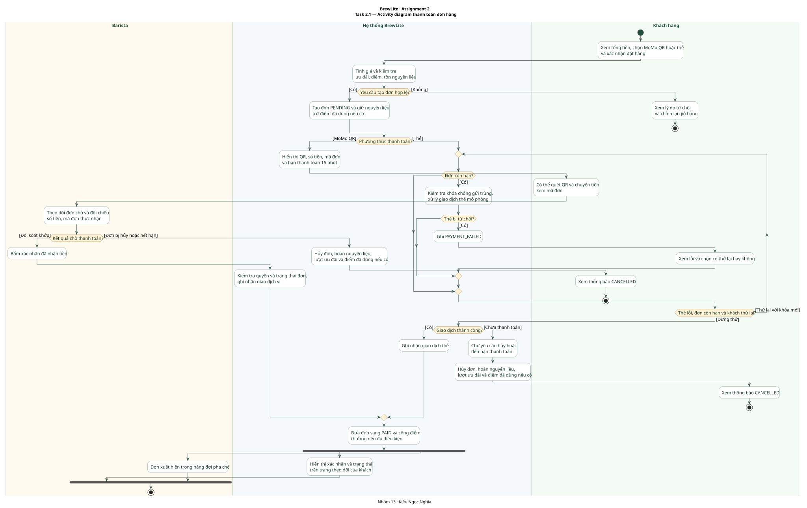

# Task 2.1 — Activity diagram thanh toán đơn hàng

**BrewLite · Assignment 2 · Nhóm 13**

**Phụ trách chính:** Kiều Ngọc Nghĩa

[Mã nguồn PlantUML](./activity-diagram-thanh-toan.puml) · [Ảnh PNG](./activity-diagram-thanh-toan.png)

## Phạm vi

Bắt đầu khi khách đã có món trong giỏ và xác nhận đặt hàng. Kết thúc khi đơn được xác nhận thanh toán và xuất hiện ở quầy, đơn bị hủy, hoặc yêu cầu tạo đơn bị từ chối. Các bước pha chế và giao đồ uống thuộc luồng xử lý đơn sau thanh toán.

- **MoMo QR.** Khách chuyển khoản kèm mã đơn. Barista đối chiếu giao dịch và xác nhận đã nhận tiền. Màn hình khách kiểm tra trạng thái đơn định kỳ và chuyển sang trang xác nhận khi nhận được trạng thái `PAID`.
- **Thẻ.** Thanh toán mô phỏng qua API. Lần thử mới sau lỗi dùng khóa mới. Gửi lại cùng khóa và cùng nội dung trả về kết quả đã lưu.
- **Hủy hoặc hết hạn.** Đơn chờ có hạn 15 phút tính từ lúc tạo. Nếu khách không thử lại thẻ và không chủ động hủy, đơn vẫn chờ cho đến khi hết hạn. Hệ thống chỉ hủy nếu trạng thái đơn cho phép và không có giao dịch đang xử lý, rồi hoàn nguyên liệu, lượt dùng ưu đãi và điểm đã sử dụng nếu có.
- **Hủy sau khi thanh toán.** Nằm sau điểm kết thúc của sơ đồ này. Đơn `PAID` vẫn có thể hủy trước khi pha chế. Hệ thống thu hồi điểm thưởng đã cộng và ghi nhận hoàn tiền mô phỏng nếu có giao dịch thành công.

## Truy vết để nhóm đối chiếu

Bảng dưới đây dùng tên yêu cầu nghiệp vụ tạm thời. Điền mã FR và mã use-case chính thức sau khi Task 1.2 và 1.3 được nhóm chốt.

| Yêu cầu nghiệp vụ | Nhánh trên sơ đồ | API liên quan | Kiểm thử đối chiếu |
|---|---|---|---|
| Tạo đơn và giữ nguyên liệu | Kiểm tra giá, ưu đãi, điểm và tồn kho | `POST /api/orders` | `orders.service.spec.ts` kiểm tra tạo đơn, dùng điểm và thiếu nguyên liệu |
| Thanh toán MoMo QR | Barista đối chiếu và xác nhận đã nhận tiền | `PATCH /api/orders/:id/status`, `GET /api/orders/:id` | Kịch bản MoMo QR trong README, xác minh thủ công phía khách và quầy |
| Thanh toán thẻ và thử lại | Thành công hoặc `PAYMENT_FAILED` rồi thử lại | `POST /api/payments` | `payments.service.spec.ts` kiểm tra thành công, thất bại, thử lại và gửi trùng |
| Hủy hoặc hết hạn | Hoàn phần đã giữ và chuyển `CANCELLED` | `POST /api/orders/:id/cancel`, tác vụ quét đơn hết hạn | `orders.service.spec.ts` kiểm tra hoàn kho, hết hạn và chặn hủy khi giao dịch đang xử lý |

Cơ sở đối chiếu là [BrewLite-A2 tại commit `438a5ea`](https://github.com/Thaitruong26/Brewlite-A2/tree/438a5ea0001f3ae4554389491c4d24041f9f5811), gồm README, trang checkout và payment, cùng các module orders và payments.
